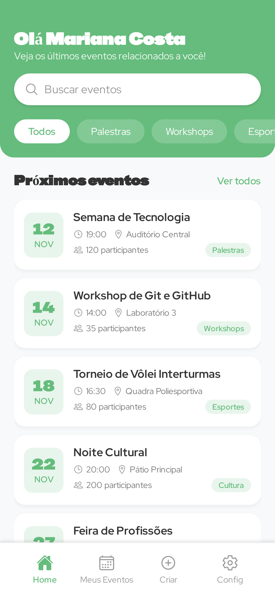

# Agenda Institucional

App mobile para a comunidade de uma instituição de ensino, com acesso pelo e-mail institucional.

Foi meu primeiro projeto em React Native. Criei ele para aprender desenvolvimento mobile na prática: como estruturar um app, controlar a navegação entre telas e integrar autenticação com um back-end real.

<p align="center">
  
  &nbsp;&nbsp;
  
</p>

## O que aprendi

- **Autenticação com Supabase**: cadastro, login e sessão persistida, para o usuário não precisar entrar de novo toda vez que abre o app
- **Navegação baseada em estado**: o app decide sozinho se mostra o login ou a Home, de acordo com a sessão
- **Context API**: compartilhar o usuário logado entre as telas sem passar dados manualmente
- **Organização de projeto mobile**: separação entre páginas, componentes, rotas, contexto e configuração
- **Build Android com EAS**: gerar o APK para instalar e testar no celular

## Tecnologias

- **React Native** com **Expo**
- **Supabase** (autenticação)
- **React Navigation** (native stack)
- **AsyncStorage**
- **EAS Build**

## Estrutura

```
src/
├── Pages/        # Welcome, SignIn, SignUp, Home, Loading
├── contexts/     # AuthContext: usuário logado e estado de sessão
├── routes/       # Navegação e redirecionamento por autenticação
└── lib/          # Cliente do Supabase
constants/        # Cores e configuração
```

## Como rodar

```bash
npm install
npx expo start
```

Configure a URL e a chave anônima do seu projeto Supabase em `constants/supabase.js`.

## Autor

**Arthur Roberto Alves** · [LinkedIn](https://www.linkedin.com/in/arthur-roberto-alves-bb83b0354/)
